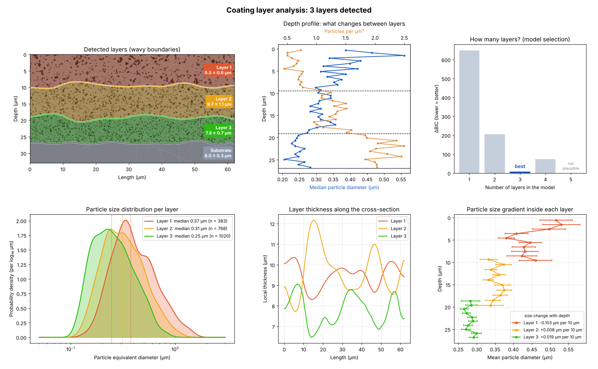
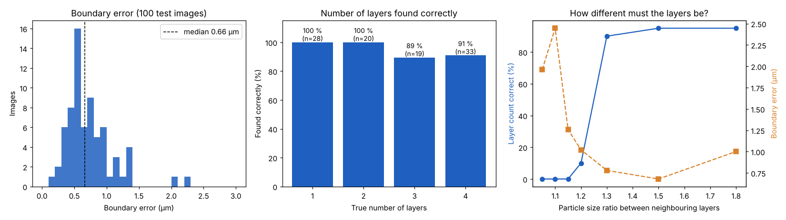
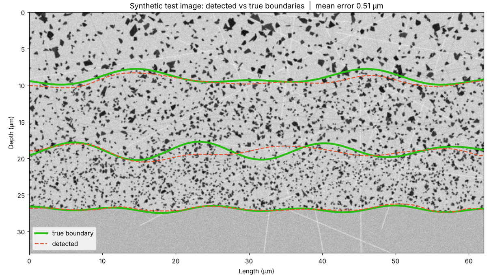
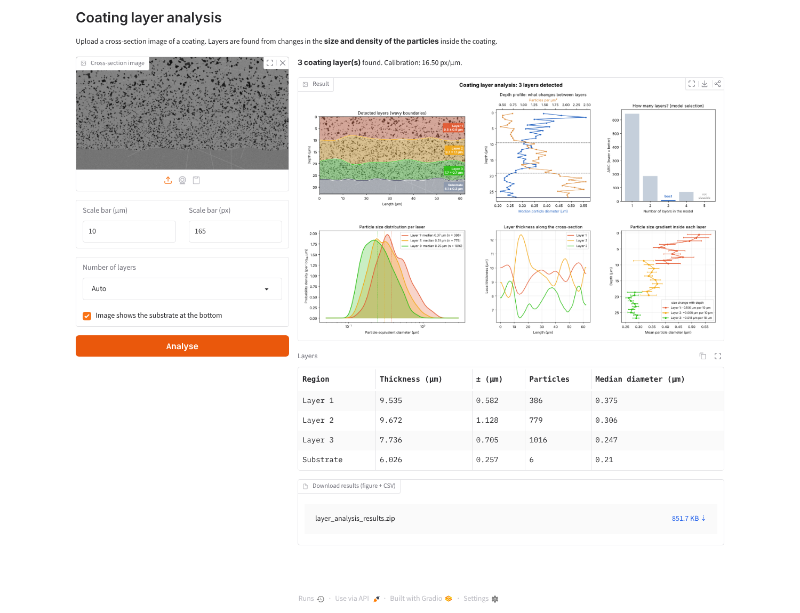

# Coating Layer Analysis

Automatic detection of the **layers of a coating in a cross-section micrograph**, using the size and density of the particles inside the coating. The tool finds the substrate interface, decides how many layers there are, traces the wavy boundaries between them, and measures the thickness, area and particle statistics of every layer in micrometres.



**Skills shown:** image processing (OpenCV, scikit-image) · change-point detection · statistical model selection (BIC, maximum likelihood) · validation with synthetic ground truth · data visualisation · a command-line tool and a small web app (Gradio)

---

## The problem

Many coatings are deposited in several layers, for example with different process parameters. In a cross-section the layers often look almost the same: same matrix, same kind of dark particles (pores, inclusions, precipitates). What changes from one layer to the next is the **particle size**, and with it the number of particles per area. Measuring layer thickness by hand means guessing where that change happens, image after image.

## How it works

| Step | Method |
|---|---|
| 1. Particles | Otsu threshold, connected components, equivalent diameter of each particle |
| 2. Substrate | Per image column: particle density + texture are high in the coating and low in the smooth substrate. The interface is placed where this signal drops, then moved to the strongest vertical intensity gradient |
| 3. Depth profile | Median particle size and particle density in thin depth bins (0.6 µm) |
| 4. Initial boundaries | Change-point detection (binary segmentation) on the depth profile |
| 5. Wavy boundaries | At 60 positions along the cross-section, the particles in an overlapping window are sorted by depth, and the boundary is placed at the most likely split (two particle-size distributions and two densities). The curve is then median- and Gaussian-smoothed |
| 6. Number of layers | Models with 1 to 5 layers are compared with the **Bayesian Information Criterion** on the individual particles. A model only counts if it is physically plausible: every layer ≥ 1 µm thick, and neighbouring layers differ by ≥ 15 % in particle size or ≥ 30 % in density |
| 7. Measurements | Thickness (mean, ±, min, max) and area per layer, particle size distribution per layer, particle size gradient inside each layer |

## Results

The method was validated on synthetic cross-sections where the true layers are known (`make_synthetic.py`). The test set has **100 new images** that were not used during development: 1 to 4 layers, thicknesses of 5 to 14 µm, different particle sizes and densities, wavy boundaries, noise and polishing scratches.

| Metric | Result |
|---|---|
| Number of layers found correctly | **95 %** |
| Boundary error, median | **0.66 µm** |
| Boundary error, 90th percentile | **1.31 µm** |
| Substrate interface error, median | **0.42 µm** |

Boundary error = mean vertical distance between the detected and the true boundary, measured with the true number of layers given. The image is 16.5 px/µm, so 0.66 µm is about 11 pixels, on boundaries that are themselves wavy (up to about ±2 µm).

When the number of layers is wrong (5 of 100 images), the method always finds **fewer** layers than there are, never more: it does not invent layers.



**How different must the layers be?** In a second test, the particle-size ratio between neighbouring layers was lowered step by step. The method finds the layers reliably from a ratio of **1.3** (30 % size difference): 90–95 % correct. At a 20 % difference or less it reports a single layer, which is the safe way to fail.



### Design choices

1. **Median size and particle density, not the mean size.** A mean diameter per depth bin reacts strongly to a few large particles. The median of the log-diameter is robust, and the particle density often changes even more between layers than the size (smaller particles are more numerous).
2. **Boundaries from individual particles.** Narrow image columns contain only a few particles, so a boundary refined column by column on binned averages is noisy. Here each boundary point is the most likely split of the particles in an overlapping window, which is not limited by the bin height.
3. **Choosing the number of layers after fitting the boundaries.** A wavy boundary looks like a gradual ramp in a depth profile, and a model selection on that profile tends to add extra layers to follow the ramp. The BIC is therefore computed on the particles once the wavy boundaries are fitted, together with a plausibility check (minimum thickness and minimum difference between neighbouring layers).

## Usage

```bash
pip install -r requirements.txt
python make_synthetic.py                                   # demo image -> demo/cross_section.png

# one image or many (one results folder per image + summary.csv)
python analyze.py demo/cross_section.png --px-per-um 16.5
python analyze.py my_images/*.tif --px-per-um 16.5 --out results
python analyze.py sample.tif --px-per-um 45 --layers 2     # if you know the number of layers

# web app: upload an image, enter the scale bar, download figure + CSV
python app.py

# reproduce the validation (~3 min)
python validate.py
```

`--px-per-um` is the calibration from the scale bar (10 µm = 165 px → 16.5).

In Python:

```python
from layer_analysis import Params, analyze, load_gray
from plot import plot_analysis

res = analyze(load_gray("my_cross_section.tif"), Params(px_per_um=16.5))
plot_analysis(res)
res.layer_table()        # thickness, area, particles per layer
res.boundary_table()     # boundary depth along the cross-section (µm)
res.gradient_table()     # particle size vs depth inside each layer
```

[`demo.ipynb`](demo.ipynb) walks through every step with figures.



### Output files (per image)

| File | Content |
|---|---|
| `analysis.png` | overview figure (as above) |
| `layers.csv` | per layer: mean thickness, ±, min, max, area, number of particles, mean/median diameter, particle area fraction |
| `boundaries.csv` | depth of every boundary and of the substrate interface along the cross-section |
| `particles.csv` | every particle: position, diameter, area, layer |
| `gradient.csv` | mean particle diameter vs depth inside each layer |
| `summary.csv` | one row per image, to compare samples |

## Project structure

```
coating-layer-analysis/
├── layer_analysis.py    # the method: particles, substrate, profiles, change points, BIC, boundaries, tables
├── plot.py              # overview figure, comparison with ground truth
├── analyze.py           # command-line tool (single image or batch)
├── app.py               # Gradio web app
├── make_synthetic.py    # synthetic cross-sections with known layers
├── validate.py          # validation experiments
├── demo.ipynb           # step-by-step demo with outputs
├── demo/                # synthetic demo image (+ ground truth)
├── images/              # figures and validation tables for this README
├── requirements.txt
└── LICENSE
```

## Limitations

* The layers must differ in **particle size or density**. Layers that differ only in chemistry or grey level are not separated (see the contrast test above: below about 20–30 % size difference, they are reported as one layer).
* The thickness of the top layer is its **visible** thickness if the image does not include the coating surface.
* Boundaries that wave on a scale shorter than the refinement window (about 4 µm) are smoothed out.
* The validation uses synthetic images. On real samples, the boundary positions should be checked against a few manual measurements, as with any new measurement method.
* Particles that touch are measured as one particle, which slightly increases the measured sizes in dense layers.

## Context

Developed while working on image analysis of electroplated coatings at a university research centre. Only the code is published here; the demo and validation use synthetic images.

It was also tested on real cross-sections from that work (not published): it placed the boundaries where the particle size visibly changes, and on two samples it also found a thin zone of finer, denser particles just above the substrate, which still has to be confirmed against the deposition process.

## License

[MIT](LICENSE)
